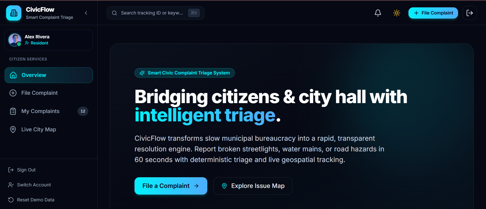
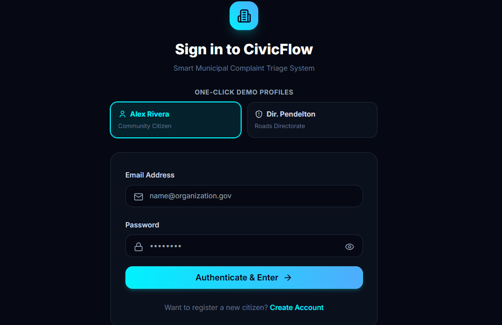
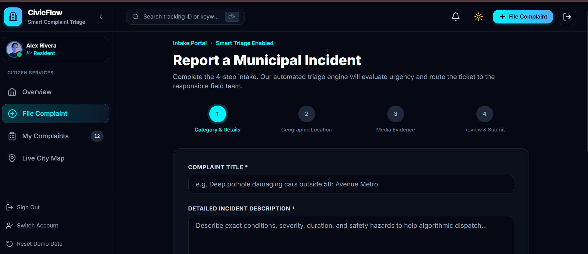
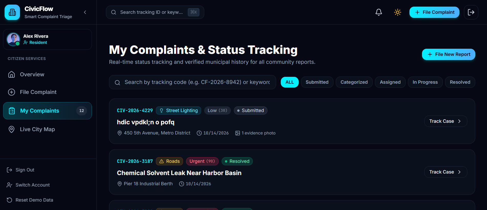
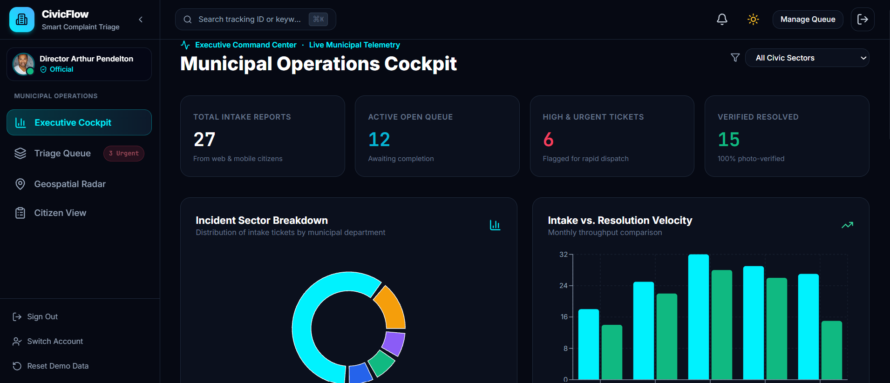
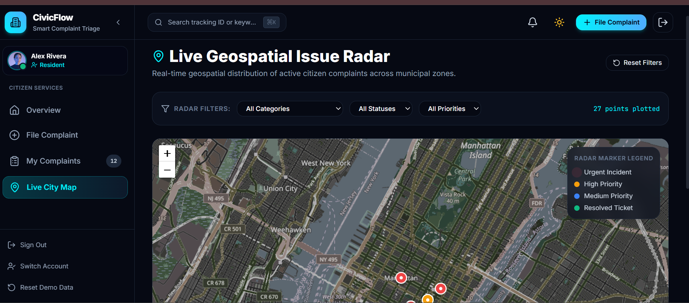
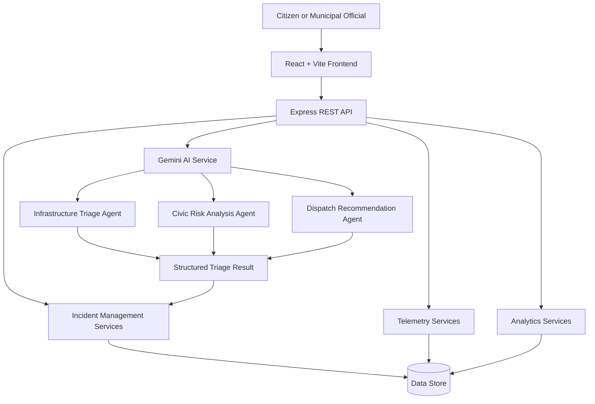

# CivicSense AI 🏙️
### Institutional Municipal Command Center & Multi-Agent Telemetry Engine

**Turning civic complaints into actionable municipal intelligence.**

CivicSense AI is a civic-tech platform designed to modernize how municipalities receive, analyze, prioritize and resolve public infrastructure complaints. It combines an institutional command-center interface, structured incident management, municipal telemetry monitoring and a Google Gemini-powered multi-agent triage workflow.

Instead of treating every complaint as an isolated report, CivicSense AI aims to connect citizen reports, risk signals, departmental routing and resolution tracking in one operational workspace.

> **Project:** SC-01 — Smart Civic Complaint Triage System  
> **Category:** Smart Communities & Public Services  
> **Built with:** React · TypeScript · Node.js · Express · Google Gemini  
> **Focus:** AI-assisted triage, incident management, telemetry and municipal operations

---

## 📸 Project Preview

<!-- Add your actual screenshots to docs/screenshots/ using the filenames below. -->

### Command Center




*The central operational view for monitoring civic incidents, priorities and municipal activity.*

### AI-Powered Incident Triage



*The triage interface for examining incident details, risk signals and recommended departmental routing.*

### Incident Management & Tracking




*The incident workflow for reviewing reports, assigning departments and tracking resolution.*

### Municipal Telemetry & Analytics



*The monitoring and analytics views for examining simulated telemetry signals and incident trends.*

**Note:** These image paths are placeholders until you add your actual screenshots. Use screenshots captured from the running application rather than conceptual UI references.

---

## 🚨 The Problem

Municipal complaint handling can become fragmented when citizen reports, departmental assignments, infrastructure monitoring and resolution updates live in separate workflows.

This can make it harder to:

- Identify urgent infrastructure issues.
- Recognize repeated complaints about the same location.
- Route reports to the appropriate department.
- Understand workload and outstanding incidents.
- Maintain a transparent record of decisions and actions.
- Track a complaint from submission through resolution.

## 💡 The Solution

CivicSense AI brings these workflows into one municipal command center.

The platform is designed to combine structured complaint intake, AI-assisted analysis, rule-based prioritization, departmental dispatch recommendations, telemetry monitoring and an auditable incident lifecycle.

Its central principle is simple:

**Report → Analyze → Prioritize → Assign → Resolve → Review**

AI supports the workflow by providing recommendations and explanations. Municipal staff retain control over operational decisions.

---

## ✨ Core Features

### 1. 🧠 Multi-Agent AI Triage

A Google Gemini-powered analytical workflow separates incident assessment into three specialized perspectives.

| Agent | Responsibility |
|---|---|
| Infrastructure Triage Specialist | Examines the reported infrastructure issue, potential failure modes and possible physical hazards. |
| Civic Sentiment & Risk Analyst | Evaluates reported distress, potential community disruption and contextual risk signals. |
| Municipal Dispatch Commander | Synthesizes the analysis into a suggested department, work-order direction and crew requirements. |

The intended workflow combines these perspectives into a structured triage result that can assist staff with incident review and routing.

AI-generated assessments are recommendations, not verified facts. High-risk cases require appropriate human review.

### 2. 🚦 Incident Prioritization

Organize reported issues according to their operational priority.

- Surface urgent and high-priority cases.
- Support structured incident categorization.
- Provide a consistent view of outstanding work.
- Help staff understand why an incident has been flagged.
- Preserve human oversight over priority changes.

### 3. 🏢 Departmental Routing

Support the routing of incidents to relevant municipal teams, such as:

- Water and sanitation
- Roads and infrastructure
- Electrical and street lighting
- Transit and traffic infrastructure
- Emergency-response teams, where appropriate

Department names and assignments can be configured to match the municipality or demonstration environment.

### 4. 📡 Municipal Telemetry Monitoring

The telemetry module provides a centralized view of simulated municipal sensor signals and operational indicators.

It is designed to support:

- Sensor and telemetry status monitoring.
- Visibility into abnormal readings and simulated spikes.
- Incident correlation workflows.
- Operational monitoring through a unified dashboard.

**Telemetry distinction:** Simulated sensor data demonstrates the workflow; it does not represent verified live municipal infrastructure unless real sensor integrations are configured.

### 5. 📊 Analytics & Operational Overview

The analytics module provides an overview of complaint activity and municipal operations.

Potential dashboard indicators include:

- Total incidents and outstanding reports.
- Complaint distribution by category.
- Priority distribution.
- Departmental workload.
- Resolution activity.
- Recent system and administrative events.

Where data is available, these indicators should be derived from actual application records rather than unrelated hardcoded numbers.

### 6. 🧾 Incident Lifecycle & Audit History

Support a structured incident lifecycle:

**Submitted → Categorized → Assigned → In Progress → Resolved**

The system architecture includes report management, administrative operations and audit-related functionality to help maintain a traceable record of incident handling.

### 7. 🖥️ Institutional Command-Center UI

CivicSense AI uses a Swiss-inspired visual design approach focused on information clarity and operational density.

Design characteristics include:

- Deep navy institutional navigation: `#17324D`
- Civic teal: `#0F9D92`
- Informational cobalt: `#2563EB`
- Neutral canvas: `#F5F7FA`
- White data surfaces: `#FFFFFF`
- Subtle borders: `#E4E7EC`
- Inter typography and tabular numerals
- Compact data cards, clear status indicators and structured tables

The goal is to make complex operational information easier to scan without overwhelming the user with unnecessary decoration.

---

## 🏗️ System Architecture

CivicSense AI follows a modular client-server architecture.



### Architecture overview

- **Frontend:** Presents the command center, incident views, telemetry and analytics.
- **Backend API:** Handles application requests and coordinates business logic.
- **Incident services:** Manage complaint records and operational workflows.
- **Gemini service:** Coordinates AI-assisted incident analysis.
- **Telemetry services:** Provide sensor readings and simulated monitoring events.
- **Analytics services:** Aggregate operational data for the dashboard.
- **Data layer:** Stores application data according to the configured persistence implementation.

The repository includes an in-memory store and a Prisma schema for PostgreSQL. Document the active persistence configuration accurately when publishing: a schema file alone does not mean PostgreSQL is connected or that data persists across server restarts.

---

## 🧰 Technology Stack

| Layer | Technology |
|---|---|
| Frontend framework | React 18+ |
| Frontend tooling | Vite |
| Language | TypeScript |
| Styling | Tailwind CSS |
| API framework | Node.js + Express |
| AI integration | Google Gemini |
| Database schema | Prisma + PostgreSQL schema |
| API architecture | REST endpoints |
| Security middleware | Helmet and rate limiting |
| Development environment | npm |
| Local service ports | Frontend `5173`, API `5000` |

Actual authentication, persistence, AI integration and test coverage should be documented according to the current repository implementation.

---

## 📁 Project Structure

```text
new project/
├── client/
│   ├── src/
│   │   ├── components/
│   │   │   ├── modules/
│   │   │   │   ├── AITriageDrawer.tsx
│   │   │   │   ├── IncidentReportModal.tsx
│   │   │   │   └── TelemetryGrid.tsx
│   │   │   └── ui/
│   │   │       ├── Button.tsx
│   │   │       ├── DataTable.tsx
│   │   │       ├── FormInput.tsx
│   │   │       ├── KpiMetricCard.tsx
│   │   │       └── StatusBadge.tsx
│   │   ├── types/
│   │   ├── App.tsx
│   │   ├── index.css
│   │   └── main.tsx
│   ├── tailwind.config.js
│   ├── vite.config.ts
│   └── package.json
├── server/
│   ├── prisma/
│   │   └── schema.prisma
│   ├── src/
│   │   ├── controllers/
│   │   ├── db/
│   │   │   └── store.ts
│   │   ├── routes/
│   │   │   └── v1/
│   │   ├── services/
│   │   │   └── gemini.service.ts
│   │   ├── types/
│   │   └── server.ts
│   ├── .env.example
│   └── package.json
├── docs/
│   └── screenshots/
├── package.json
└── README.md
```

*This tree describes the intended module organization. Exact filenames and folders may differ slightly in the current working branch.*

---

## 🔌 API Overview

The following endpoints are defined in the project documentation.

| Method | Endpoint | Purpose |
|---|---|---|
| `GET` | `/api/v1/health` | Check API health. |
| `GET` | `/api/v1/reports` | Retrieve civic incident reports. |
| `GET` | `/api/v1/telemetry` | Retrieve municipal telemetry data. |
| `POST` | `/api/v1/telemetry/simulate` | Trigger a simulated telemetry spike. |
| `GET` | `/api/v1/analytics/overview` | Retrieve the operational analytics overview. |

These are the documented routes; verify that each endpoint is registered and working in the current branch before treating this table as a live API contract.

### Example: Health check

```bash
curl http://localhost:5000/api/v1/health
```

### Example: Retrieve reports

```bash
curl http://localhost:5000/api/v1/reports
```

### Example: Retrieve telemetry

```bash
curl http://localhost:5000/api/v1/telemetry
```

### Example: Simulate a telemetry spike

```bash
curl -X POST http://localhost:5000/api/v1/telemetry/simulate
```

The simulation endpoint may require a request body or additional parameters depending on the implemented route. Check the route handler for its exact contract.

---

## ⚙️ Getting Started

### Prerequisites

- Node.js 20+ or a compatible supported release
- npm 10+
- Google Gemini API access if live AI analysis is enabled
- PostgreSQL only if the active application configuration requires it

### 1. Clone the repository

```bash
git clone <YOUR_GITHUB_REPOSITORY_URL>
cd <YOUR_PROJECT_DIRECTORY>
```

Replace the placeholders with your actual GitHub repository URL and project directory.

### 2. Install dependencies

If the root package includes an installation script:

```bash
npm run install:all
```

Otherwise, install dependencies from the root, `client/` and `server/` directories according to their respective `package.json` files.

### 3. Configure environment variables

Create a server-side `.env` file based on `.env.example`.

For example:

```env
PORT=5000
GEMINI_API_KEY=your_gemini_api_key
```

Add database and authentication variables only when required by the actual implementation.

**Security:** Never commit `.env` files, API keys, database credentials or other secrets to GitHub. Keep the Gemini API key on the server, not in frontend environment variables.

### 4. Start the backend

Open a terminal in the project root:

```bash
npm run dev:server
```

Expected local API address:

```text
http://localhost:5000
```

### 5. Start the frontend

Open a second terminal:

```bash
npm run dev:client
```

Open the application at:

**http://localhost:5173**

### 6. Verify the API

Visit:

```text
http://localhost:5000/api/v1/health
```

Confirm that the server is healthy before testing the frontend workflows.

---

## 🧪 Testing & Verification

The project should be validated across its primary operational workflows.

- [ ] Frontend starts successfully.
- [ ] Backend starts successfully.
- [ ] Health endpoint returns the expected response.
- [ ] Reports can be retrieved and submitted as implemented.
- [ ] AI triage returns a structured result when configured.
- [ ] Telemetry endpoints return the expected data.
- [ ] Analytics reflect the underlying report data.
- [ ] Administrative changes are recorded correctly.
- [ ] Errors and unavailable integrations are handled gracefully.
- [ ] No secrets are exposed in the frontend bundle or repository.

Add your actual test command and verified results here after running them. Do not claim a passing test count or production readiness without confirming it against the current branch.

---

## 🔐 Security & Responsible AI

CivicSense AI is intended to assist municipal staff, not replace accountable decision-making.

Key considerations:

- Keep AI credentials server-side.
- Validate incoming requests on the backend.
- Apply authorization checks to sensitive administrative actions.
- Restrict access to private complaint information.
- Use rate limiting and secure HTTP headers.
- Record significant administrative changes where audit logging is implemented.
- Treat AI-generated assessments as recommendations that may be wrong.
- Require human review for consequential priority and dispatch decisions.
- Use fictional or appropriately anonymized data in demonstrations.

A production deployment should also verify database permissions, session security, upload validation, retention rules and the privacy implications of collecting complaint locations and photographs.

---

## 🚀 Roadmap

Potential future improvements include:

- [ ] Production-grade persistent storage and migrations
- [ ] Stronger duplicate detection using text and geographic similarity
- [ ] Explainable, configurable triage rules
- [ ] Live municipal sensor integrations
- [ ] Map-based incident clustering and geographic analysis
- [ ] Citizen notifications and resolution feedback
- [ ] Multilingual complaint submission
- [ ] Department-level performance reporting
- [ ] Accessibility and usability improvements
- [ ] Automated API and end-to-end tests

Items on this roadmap should be treated as planned enhancements unless already implemented.

---

## 🌍 Real-World Impact

CivicSense AI explores how AI-assisted workflows can help municipal teams organize incoming complaints, identify potentially important incidents and route work more consistently.

Its intended value is not simply to add AI to a dashboard. It is to connect **citizen reporting, analytical support, operational assignment and accountable resolution tracking** into one coherent system.

The project is a prototype and does not claim integration with an official municipal authority or live emergency-response infrastructure unless such an integration is explicitly configured.

---

## 👩‍💻 Built For

**SC-01 — Smart Civic Complaint Triage System**

A hackathon project exploring AI-assisted civic infrastructure reporting, municipal intelligence and transparent incident management.

### Contributing

Contributions and constructive feedback are welcome. If you want to improve CivicSense AI, open an issue describing the problem or submit a pull request with a clear explanation of the change.

### License

Add a `LICENSE` file and name the selected license here before inviting reuse or redistribution.

---

<p align="center">
  <strong>CivicSense AI</strong><br/>
  Making civic intelligence more actionable, one incident at a time.
</p>
